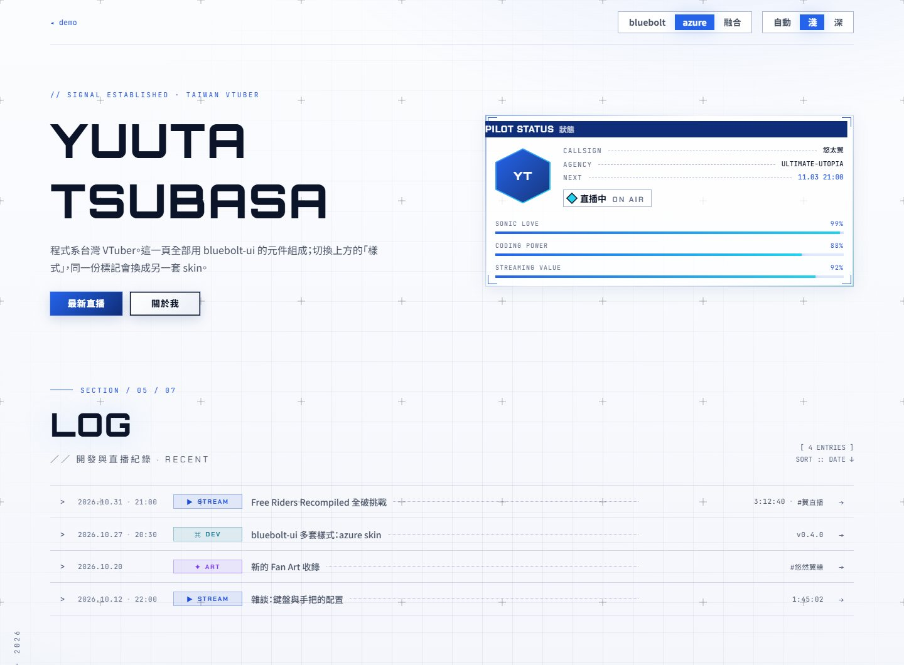
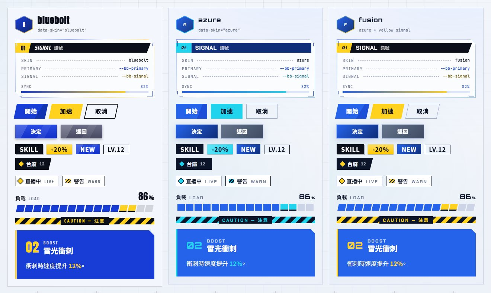
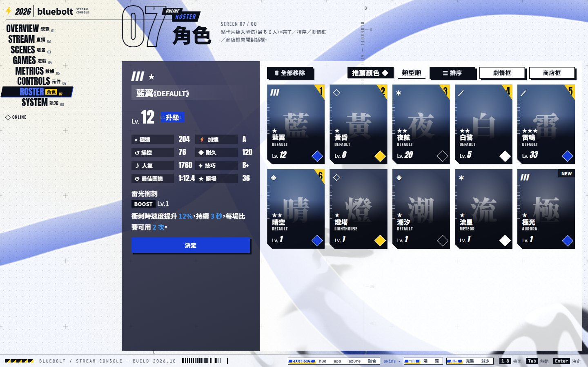
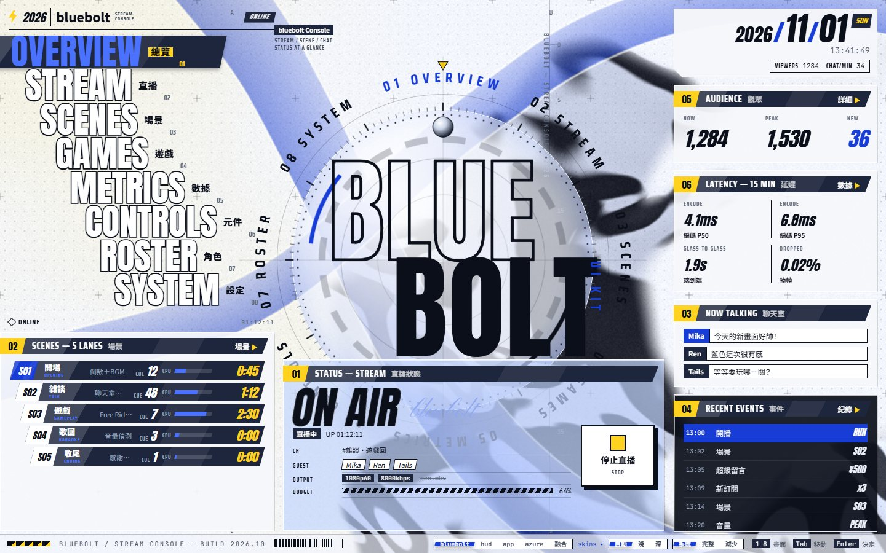
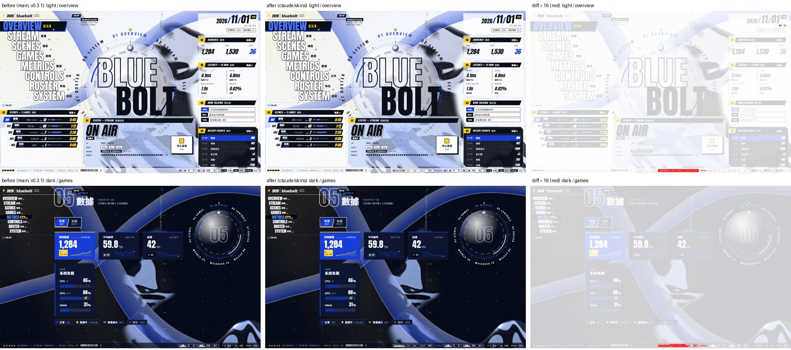

# 多套樣式（skin）

bluebolt-ui 從 v0.4.0 起可以換「樣式」：同一組元件，換一套顏色、字型、形狀與質感。bluebolt 至今參考過三個來源，各整理成一套 skin：

| # | skin | 來源 | 長相 |
| --- | --- | --- | --- |
| ① | `hud` | v0.2：參考 [html-in-canvas 直播控制台 demo](https://matchachoco010.github.io/demo-html-in-canvas-bot-dashboard/)（只參考風格） | 藍白黃黑遊戲 HUD：純色斜切色板、6px 硬陰影、黑色標題帶、虹彩邊毛玻璃；Anton＋Saira Condensed |
| ② | `app` | v0.3：參考手遊的選單、對話框、設定畫面截圖（只取配色與版面） | 同一套藍白黃黑，但是斜切高光的漸層面、柔和陰影、深藍標題列、不透明淺色面板、正體標題 |
| ③ | `azure` | 主網站 yuuta-tsubasa.studio | 銀灰字＋電光藍 `#2563EB`、青色訊號、毛玻璃、細格線、柔光取代硬陰影、方正邊角；Orbitron＋Chakra Petch＋Noto Sans TC＋JetBrains Mono |
| — | `bluebolt`（預設） | v0.3.1 原樣 | ①＋② 並存：HUD 版面元件（StairMenu、RingDial、Panel、GameMenu…）用 ①，應用層元件（Modal、SettingsShell、OptionGrid、`Button shape="rect"`…）用 ②。**和 v0.3.1 一模一樣** |

①② 在 repo 裡不是兩個資料夾，而是同一個套件的兩層元件：v0.2 做了 HUD 元件，v0.3 加了應用層元件和它們專用的 token（`--bb-face-*`、`--bb-sys-*`、`--bb-navy`）。`hud` 把 ① 的樣子套到應用層元件上，`app` 把 ② 的樣子套到 HUD 元件上；兩者都以 `bluebolt` 為底，只覆寫有差的 token。



## 怎麼用

```js
import 'bluebolt-ui/styles.css';   // 含兩套 skin 與兩套字型
import { setSkin } from 'bluebolt-ui';

setSkin('azure');     // 'bluebolt'（預設）| 'hud' | 'app' | 'azure'
```

或直接寫屬性：

```html
<html data-skin="azure" data-theme="dark">
```

`data-skin` 也能放在**任何元素**上，只換那一塊（例如 bluebolt 頁面裡放一個 azure 卡片，或反過來）。

三個屬性各自獨立、可任意組合：

| 屬性 | 值 | 管什麼 |
| --- | --- | --- |
| `data-skin` | `bluebolt`（預設）／`hud`／`app`／`azure` | 顏色、字型、形狀、質感 |
| `data-theme` | 不設＝跟系統／`light`／`dark` | 淺色或深色；每套 skin 都有兩種 |
| `data-motion` | 不設＝跟系統／`full`／`reduce` | 動態量；和 skin 無關 |

只要預設 skin 的專案（RingRoad、ProjectVtuber、直播封面、Zebar HUD、VirtualLegends）不用改任何東西。

## 為什麼分兩層

盤點三個來源之後，**骨架**幾乎一樣，差的是**皮**：

| 共通骨架（元件的結構） | 真正不同的部分（skin 填的值） |
| --- | --- |
| 紙底＋HUD 細線與格點、角落括號、直排小字、底部 Ticker、毛玻璃 Panel、Tag／Chip、帶編號的段落標題、等寬字的遙測列、進度條、選單與按鈕 | 顏色（黃黑訊號 vs 青藍訊號、黑字 vs 銀灰字）、字型（Anton 窄體 vs Orbitron 寬體）、形狀（−12° 斜切 vs 方正切角）、陰影（① 6px 硬陰影、② 柔和投影、③ 藍色柔光）、面（① 純色、② 斜切高光漸層、③ 平滑漸層）、標題帶（① 黑、② 深藍、③ 電光藍深色）、玻璃（① 虹彩邊、② 不透明淺色、③ 細框）、背景（點格 vs 線格＋漸層光暈） |

所以 token 分成兩層：

1. **語意層**：元件**只認**這些變數，名稱講用途不講顏色，例如 `--bb-primary`、`--bb-signal`、`--bb-ink`、`--bb-paper`、`--bb-font-display`、`--bb-cut`、`--bb-glow`。
2. **skin 層**：`src/lib/styles/skins/<名稱>.css`，只負責把語意層填上值，不寫任何元素樣式。

元件裡原本寫死的顏色（`#0b0f1a`、`#ffffff`、設定畫面的藍色漸層等）、字型、斜切角度、硬陰影，全部改成讀語意層。新 skin 只要填值，不用動元件。

### 層疊順序

skin 放在 CSS cascade layer 裡：

```css
@layer bb-tokens, bb-skins;   /* 後面的層贏 */
```

- `bb-tokens`：預設 skin（bluebolt，同時是 `hud`／`app` 的底）＋共用 token（字級、間距、動態）＋舊名稱別名。
- `bb-skins`：其他 skin（`hud`、`app`、`azure`）。因為層比較後面，不管選擇器權重或載入順序，`data-skin="azure"` 一定蓋過預設 skin 的深色模式規則。
- 沒放進層的 CSS（使用端自己寫的）永遠最優先，所以 app 想微調某個 token，直接在 `:root` 或某個元素上覆寫就好，不用拚權重。

### 舊名稱

v0.3 以前的名稱都保留成別名，讀它們的 app 在任何 skin 下都正常：

| 舊名（仍可用） | 語意名 |
| --- | --- |
| `--bb-blue`、`-shade`、`-2`、`-soft`、`-deep`、`-text` | `--bb-primary`、`-shade`、`-2`、`-soft`、`-deep`、`-text` |
| `--bb-on-blue` | `--bb-on-primary` |
| `--bb-yellow`、`-soft`、`-deep` | `--bb-signal`、`-soft`、`-deep` |
| `--bb-on-yellow` | `--bb-on-signal` |
| `--bb-sky` | `--bb-accent` |
| `--bb-face-blue`、`--bb-face-yellow` | `--bb-face-primary`、`--bb-face-signal` |
| `--bb-font-zh`、`--bb-font-cond` | `--bb-font-body`、`--bb-font-tech` |

別名只用來「讀」。要改值請改語意名（改 `--bb-blue` 不會影響元件）。

## 語意 token 一覽

**顏色**

| token | 用途 |
| --- | --- |
| `--bb-paper`、`--bb-page` | 底色；`page` 是整頁背景（可以是漸層），bluebolt 等於 `paper` |
| `--bb-surface` | 卡片、色板 |
| `--bb-ink`、`-2`、`-3`、`-4` | 文字由深到淺；`-3` 以上要過 AA |
| `--bb-line`、`--bb-line-2` | 細線、較明顯的線 |
| `--bb-black`、`--bb-white` | 兩種主題都不變的黑與白（深色標籤、對話框標題字） |
| `--bb-primary`（＋`-shade`、`-2`、`-soft`、`-deep`、`-text`）、`--bb-on-primary` | 品牌主色與放在上面的字 |
| `--bb-signal`（＋`-soft`、`-deep`）、`--bb-on-signal` | 訊號色：編號、焦點、LIVE、警示條 |
| `--bb-accent` | 深色面上的亮色強調 |
| `--bb-panel-ink`、`--bb-on-ink`、`--bb-on-ink-2` | 永遠深色的面板與上面的字 |
| `--bb-strip`、`--bb-on-strip` | 標題帶 |
| `--bb-glass`、`-strong`、`-edge`、`--bb-glass-blur`、`--bb-glass-rim`、`--bb-panel-shadow` | 毛玻璃面板 |
| `--bb-hud-line`、`--bb-hud-dot`、`--bb-grid`、`--bb-hud-dots`、`--bb-hud-grid` | HUD 線、點格與線格；後兩個是 `HudBackdrop` 點格／線格的不透明度 |
| `--bb-scrim`、`--bb-scrim-primary` | 對話框後面的遮罩 |
| `--bb-facets`、`--bb-face-*`、`--bb-gray`、`--bb-gray-shade`、`--bb-navy`、`--bb-sys-*` | 應用層（對話框、設定、按鈕）的面 |
| `--bb-chrome-lo`、`--bb-chrome-hi` | `ChromeBackground` 的金屬暗面與亮面（hex）；bluebolt 設 `none`＝用 shader 原本的黑銀 |

**字型**

| token | bluebolt | azure |
| --- | --- | --- |
| `--bb-font-display` | Anton | Orbitron（見下方「寬字型」） |
| `--bb-font-tech` | Saira Condensed | Chakra Petch |
| `--bb-font-body` | Noto Sans TC | Noto Sans TC |
| `--bb-font-mono` | JetBrains Mono | JetBrains Mono |
| `--bb-font-serif`、`--bb-font-script` | Noto Serif TC、Pinyon Script | 同 body、Chakra Petch |
| `--bb-tech-style` | `italic` | `normal`（Panel 標題） |

**形狀與質感**

（下表與上面字型表的 bluebolt 欄也是 `hud`／`app` 的值，它們只改顏色面與陰影類 token，見各 skin 檔。）

| token | bluebolt | azure | 說明 |
| --- | --- | --- | --- |
| `--bb-skew` | `-12deg` | `0deg` | 色板、選單條的傾斜 |
| `--bb-slant` | `1` | `0` | 乘數：標籤斜邊、小角度傾斜；0＝方正 |
| `--bb-hard` | `1` | `0` | 乘數：硬陰影的位移；0＝沒有硬陰影 |
| `--bb-glow` | 透明 | 藍色柔光 | 加在浮起元素上的光暈 |
| `--bb-shadow` | `6px 6px 0` 黑 | 細框＋柔和陰影 | 大面板陰影 |
| `--bb-cut`、`--bb-cut-lg` | `14px`、`16px` | `12px`、`14px` | 卡片、面板切角 |
| `--bb-stroke`、`--bb-stroke-color` | `2px` ink | `1px` line-2 | 外框按鈕、分段切換、對話框的框線 |
| `--bb-plate-sheen` | 透明 | 透明 | 疊在純色色板、標題帶上的圖層；`app` 填 `--bb-facets`（斜切高光） |
| `--bb-radius` | `2px` | `2px` | |

`--bb-slant` 與 `--bb-hard` 是乘數（像 `--bb-motion`）：元件寫 `calc(8px * var(--bb-slant))`，預設 skin 算出來正好是原本的 `8px`，所以畫面一個像素都不變。

**共用（不屬於 skin）**：字級 `--bb-text-*`、間距 `--bb-space-*`、動態 `--bb-ease*`、`--bb-dur-*`、`--bb-motion`。

## 混搭（融合）

語意層可以自由混搭。demo 的「融合」同時取三套：以 ③ azure 為底，加上 ① hud 的黃黑訊號、斜角與硬陰影，再加 ② app 的斜切高光面，不用改任何元件。`src/demo/fusion.css` 就是全部的程式：

```css
:root.demo-fusion, .demo-fusion {
  --bb-signal: #ffd21f;
  --bb-signal-soft: #fff1a8;
  --bb-signal-deep: #7a5c00;
  --bb-on-signal: #0b0f1a;
  --bb-face-signal: linear-gradient(180deg, #ffe066, #ffc800);
  --bb-black: #0b0f1a;
  --bb-strip: #0b0f1a;
  --bb-skew: -12deg;
  --bb-slant: 1;
  --bb-hard: 1;
  /* from app: facets over solid plates and faceted button faces */
  --bb-facets: linear-gradient(118deg, rgb(255 255 255 / 0.16) 0 26%, transparent 26% 58%, rgb(255 255 255 / 0.07) 58% 74%, transparent 74%);
  --bb-plate-sheen: var(--bb-facets);
  --bb-face-primary: var(--bb-facets), linear-gradient(180deg, #3b82f6, #1d4ed8);
  --bb-face-gray: var(--bb-facets), linear-gradient(180deg, #64748b, #3f4b63);
}
```

（深色主題再換一組 signal，見檔案。）



| ① hud（角色畫面：應用層按鈕變純色硬陰影） | ② app（總覽：深藍標題帶、斜切面、柔和陰影） |
| --- | --- |
|  |  |

## 新增一套 skin

從零做一套新風格（像 azure）：

1. 複製 `src/lib/styles/skins/azure.css` 成 `skins/<名稱>.css`，選擇器裡的 `azure` 換成新名稱，留在 `@layer bb-skins` 裡。
2. 把**每一個**語意 token 都填上值（淺色區塊），深色區塊至少覆寫會變的顏色。少填的 token 會沿用預設 skin 的值；在 `<html>` 上切換時，深色模式還會漏出 bluebolt 的深色值，所以寧可全部填。
3. 檢查對比度：`ink-3` 以上的文字、`on-primary`／`on-signal`、`primary-text`、`signal-deep` 對 paper 都要 ≥ 4.5:1（淺色與深色各一次）。
4. 給 shader 用的顏色（`--bb-paper`、`--bb-primary`、`--bb-primary-soft`、`--bb-signal`、`--bb-chrome-*`）要寫成 hex。
5. 需要新字型就加一個 `fonts-<名稱>.css`，在 `styles/index.css` 與 `package.json` 的 `exports` 各加一行；skin 本身也加進 `styles/index.css` 與 `exports`（`./skins/<名稱>.css`）。
6. 在 demo 的「樣式」切換（`src/demo/App.svelte`、`src/demo/Skins.svelte`）加上新選項與並排欄，跑 `npm run build`，打開 `skins.html` 看三種情況：整頁、深色、放在別的 skin 裡的子區塊。

只是 bluebolt 的變體（像 hud、app）：把名稱加進 `skins/bluebolt.css` 三個區塊的選擇器清單（讓它以 bluebolt 為底），新檔只覆寫有差的 token，放在 `@layer bb-skins`。

**不要**在 skin 檔裡寫元素樣式（`.bb-panel { … }`）。如果新 skin 需要元件做到目前做不到的事，先加一個新的語意 token（預設 skin 的值要讓畫面完全不變），再讓 skin 填它。

### 寬字型

元件的版面是照 Anton（很窄）排的。Orbitron 大約寬 1.5 倍，直接換會爆版。`fonts-azure.css` 另外定義了一個 `"Orbitron Display"` 字族：

- `size-adjust: 72%`：字本身縮小，元件不用改字級；
- `font-weight: 1 1000` 指到 800 粗的檔案：元件用 display 字型時多半沒設粗細（Anton 只有一種），這樣 azure 的標題不管元件寫什麼粗細都是網站那種粗體。

新 skin 換寬或窄的 display 字型時，照同樣的做法調 `size-adjust`。

## 從網站搬進來的元件

網站有、bluebolt 沒有，而且夠通用的，都改寫成 Svelte 5、只讀語意 token，兩套 skin 都能用：

| 元件 | 說明 |
| --- | --- |
| `Corners` | 四個 L 形角括號，放在 `position: relative` 的元素裡；`Panel` 加 `corners` 也會有 |
| `HexAvatar` | 六角形頭像，有 `src` 顯示圖片，否則顯示縮寫 |
| `ScanBar` | 細進度條＋標籤＋百分比＋流動光 |
| `Tele` | 遙測列：標籤、虛線、數值 |
| `VLabel` | 由下往上的直排小字（側欄、SCROLL ↓） |
| `LogRow` | 紀錄列：日期、分類標籤、標題＋點線、附註、箭頭；窄螢幕自動收合 |
| `SectionHead` | `SECTION / 05 / 07`＋大標題＋「／／ 中文 · 副標」＋右側 ASCII 裝飾；`glitch` 偶爾抖一下 |

沒搬的：`Cursor`（自訂游標，太偏網站個性）、`Dot`（和 `StatusLamp` 重複）、網站的 `Panel`／`Tag`／`Ticker`（bluebolt 已有，換 azure 後就是網站的樣子）、Nav／LeftRail／RightRail 與各區塊（綁網站資料）。

`ChromeBackground`／`InkBackground` 從 canvas 本身讀顏色，所以放在換了 skin 的子區塊裡也會用那一塊的顏色。

`HudBackdrop` 多了線格層（`grid`），由 skin 的 `--bb-hud-dots`／`--bb-hud-grid` 決定顯示點格還是線格；bluebolt 的線格不透明度是 0，畫面不變。

## 預設 skin 沒有變的驗證

用 Edge headless 對改動前（`main`，v0.3.1）與改動後的 demo 各拍 8 個畫面 × 淺／深兩色（固定減少動態），逐像素比對，並把同一版本連拍兩次的差異當成雜訊基準（時鐘、WebGL 顆粒、進場動畫時間點）：

- 底部 Ticker 多了「樣式」切換：預期中的差異。
- Controls 畫面的色板名稱改印新的語意名（`--bb-primary` 等）：demo 文字，預期中的差異。
- 其他差異都落在雜訊範圍內（時鐘數字、選單位置的 1px 沉降、進場動畫拍到的時間點）。


